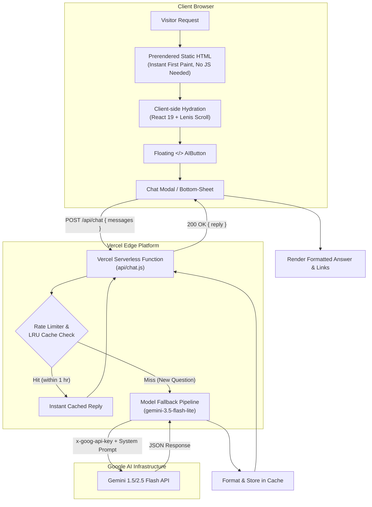
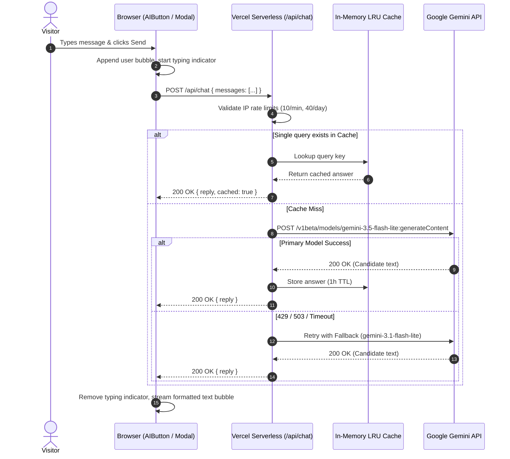

# Portfolio Architecture & Engineering Documentation

> **Developer:** Akhilesh P.  
> **Role:** Full-Stack Developer  
> **Location:** Malappuram, Kerala, India  
> **Live Website:** [https://akhileshp.com/](https://akhileshp.com/)  
> **Repository:** [github.com/akhileshp-builds/portfolio](https://github.com/akhileshp-builds/portfolio)  
> **Last Updated:** November 2026  

---

## 1. Project Overview

### What This Portfolio Is
This project is a high-performance, custom-engineered personal portfolio and technical showcase built for **Akhilesh P.**, a Full-Stack Developer based in Malappuram, Kerala. Unlike generic website templates, this application is built from the ground up using **React 19**, **Vite**, **Serverless Edge Functions**, and **Google Gemini AI**. It functions simultaneously as an interactive resume, an editorial project case study gallery, a production-grade demonstration of full-stack engineering, and a machine-readable knowledge base optimized for generative AI search engines.

### Who It Is For
- **Technical Recruiters & Engineering Managers:** Looking for verifiable proof of full-stack competence, clean architecture, responsive design, and production readiness.
- **Direct Business Clients & Founders:** Seeking a developer who can engineer enterprise ERP modules, custom business web applications, API integrations, and practical AI features.
- **Collaborators & Peers:** Interested in exploring modern web architecture patterns, hybrid SSR pre-rendering pipelines, and resilient serverless AI integrations.

### The Goal of the Site
To establish a high-authority digital presence that accurately showcases Akhilesh's unique professional transition from commerce, finance, and accounting into full-stack software engineering. It delivers a fast, accessible, cinematic user experience while ensuring that both traditional search engines (Google, Bing) and AI answer engines (ChatGPT, Gemini, Claude, Perplexity) can cite, understand, and recommend Akhilesh for developer roles.

### Elevator Pitch
> *"I bridge financial accounting precision with modern full-stack software engineering. Built with React 19, custom SSR pre-rendering, and an in-house Gemini AI assistant, this portfolio showcases production ERP systems, Django AI platforms, and high-performance web applications engineered for real business impact."*

---

## 2. About Me (Akhilesh P.)

### Professional Background
Akhilesh P. is a Full-Stack Developer based in Malappuram, Kerala, India, holding a **Bachelor of Commerce (B.Com)** from Calicut University. His background combines professional accounting, GST/tax compliance, General Ledger management, and SAP Business One experience with modern full-stack software engineering across **React**, **Python Django**, **ASP.NET Core MVC**, and **AI APIs**.

### Career Journey (Chronological Progression)
1. **Accountant Executive — myG India Private Limited (Jan 2023 – May 2024):**  
   Managed General Ledger (GL), bank reconciliations, monthly financial statements, consolidation reports, accounts payable/receivable (AP/AR), GST filing, and cost variance analysis using SAP Business One, Excel, and government compliance portals. This foundation instills domain-first thinking into software engineering.
2. **Web Developer — AllPro TechLabs (UL CyberPark, Calicut):**  
   Transitioned into frontend development, building responsive React.js web applications, movie discovery platforms, and e-commerce interfaces with REST API integrations, React Bootstrap, Material UI (MUI), and custom hooks.
3. **.NET Developer — Ebsor Infosystem Pvt. Ltd. (Dec 2024 – Mar 2026):**  
   Developed and maintained enterprise ERP web applications using ASP.NET Core MVC, C#, SQL, Entity Framework, and Kendo UI. Built Master, Transaction, and Ledger Report modules for Code7 ERP and developed the Kidonex Customer Feedback & Review module.
4. **Genstack Intern — BlackBox Learning Academy (Sept 2026 – Nov 2026):**  
   Advanced full-stack backend development using Python Django MVT, PostgreSQL (Neon), SQLite, and generative AI APIs. Engineered **TaskFlow** (an AI-powered productivity system) and **INKSPACE** (a blogging platform with Gemini AI writing assistance).
5. **Freelance Collaboration — Branding Hut (Govt. Cyberpark, Kozhikode):**  
   Collaborated on website development, technical SEO, and poster design. Contributed responsive Next.js frontend interfaces for **ApnaVilla**, a real estate web application developed alongside a Laravel backend team (project currently on hold).
6. **Active Ongoing Project Collaboration — POS Business Management Software:**  
   Leading functional planning, 12 business module definitions, input field mapping, and accounting-aligned workflows for a collaborative retail POS system alongside an ASP.NET Core backend and React frontend engineering team.

### Primary Skills Sourced from Codebase
- **Programming & Markup:** JavaScript (ES6+), Python, C#, SQL, HTML5, CSS3
- **Frameworks & UI Libraries:** React.js, Next.js, React Native, Django, ASP.NET Core MVC, .NET Core, Node.js, Express.js, Bootstrap, Tailwind CSS, Material UI (MUI), Kendo UI, jQuery
- **Databases & ORM:** PostgreSQL (Neon Serverless), SQLite, Microsoft SQL Server, Entity Framework Core, Django ORM
- **AI & Integrations:** Google Gemini API, Groq API, AI Chatbots, REST APIs, JSON-LD Structured Data
- **Developer Tools:** Git, GitHub, Vite, Visual Studio, VS Code, Postman, Render, Vercel
- **Commerce & Business Systems:** General Ledger (GL), GST/TDS Compliance, SAP Business One, Tally Prime, Financial Analysis

### Featured Projects
- **TaskFlow:** Full-stack Django task management platform featuring authentication, CRUD workflows, progress analytics, email reminders, and AI planning assistants via Gemini and Groq APIs.
- **INKSPACE:** Django blogging platform featuring CKEditor rich-text authoring, author ownership authentication, and a Google Gemini AI writing assistant.
- **Daybook:** React Native mobile productivity application combining daily planning, Plan vs. Action analytics, habit tracking, and reflection logs.
- **Code7 ERP:** Enterprise Resource Planning web application engineered with ASP.NET Core MVC, C#, SQL, REST APIs, and rich Kendo UI grid components.
- **ApnaVilla:** Real estate web application frontend engineered with Next.js in collaboration with Branding Hut's Laravel backend team (project currently on hold).
- **Kidonex Feedback & Review:** Customer review module built using ASP.NET Core MVC views, client-side JavaScript validations, and controller pipelines.
- **Streamline Consortium:** Responsive corporate engineering consultancy website built with React.js.
- **Aishka & Urban Escape:** Modern storefront and travel showcase websites emphasizing responsive cross-device layouts.

### Contact Information
- **Email:** `akhileshp.dev@gmail.com` / `akhipn4753@gmail.com`
- **Phone / WhatsApp:** +91 9526008613
- **GitHub:** [https://github.com/akhileshp-builds](https://github.com/akhileshp-builds)
- **LinkedIn:** [https://www.linkedin.com/in/akhileshp-builds/](https://www.linkedin.com/in/akhileshp-builds/)
- **Location:** Malappuram, Kerala, India (Open for local roles in Malappuram & Kozhikode, and Remote worldwide)

---

## 3. Tech Stack

| Category | Technology | Version | Why It Was Chosen |
| :--- | :--- | :--- | :--- |
| **Frontend Framework** | React | `^19.2.8` | Component-driven architecture, latest React 19 performance optimizations, concurrent rendering, and clean SSR hydration capabilities via `react-dom/client`. |
| **Client Routing** | React Router DOM | `^7.18.3` | Handles client-side navigation between homepage section anchors (`/about`, `/projects`, etc.), dynamic case studies (`/projects/:slug`), and custom 404 pages with code-split Suspense boundaries. |
| **Build Tool & Bundler** | Vite | `^8.2.2` | Instantaneous Hot Module Replacement (HMR) during local development, efficient Rollup/Rolldown production chunking, and extensible plugin APIs for custom build steps. |
| **Styling & Theming** | Pure CSS3 + Custom Properties | Native | Zero-runtime CSS-in-JS overhead; instantaneous light/dark theme switching via CSS variables; maximum performance with zero style calculation bottlenecks. |
| **Animation Physics** | Framer Motion | `^13.2.0` | Declarative spring-physics animations for viewport reveals (`FadeIn`), magnetic hover pull (`MagneticButton`), and card tilts (`TiltCard`). Configured with `LazyMotion` strict mode to strip unnecessary runtime payload. |
| **Smooth Scrolling** | Lenis | `^1.3.27` | Momentum-based, lightweight inertia smooth scrolling that unifies desktop and mobile scroll behavior and synchronizes with modal scroll locking. |
| **Micro-Interactions** | Canvas Confetti | `^1.9.4` | Renders GPU-accelerated canvas confetti bursts on contact form submission without DOM element bloat. |
| **Iconography** | Lucide React | `^1.41.0` | Clean, modern, tree-shakeable SVG icon set with consistent visual weight and zero external font file dependencies. |
| **Linter** | Oxlint | `^1.79.0` | High-speed Rust-based linter executing static code checks 50x to 100x faster than traditional ESLint setups. |
| **Serverless / AI Proxy** | Vercel Serverless Function | Node.js Runtime | Secure server-side proxy (`/api/chat.js`) ensuring API keys remain hidden while enforcing rate limits, timeouts, and fallbacks. |
| **Generative AI API** | Google Gemini API | `v1beta` | Powers the embedded portfolio assistant via `gemini-3.5-flash-lite` (with fallback to `gemini-3.1-flash-lite` and `gemini-3.5-flash`). |
| **Hosting & Edge CDN** | Vercel | Production | Global edge delivery, automatic HTTPS, clean URL rewrites, fine-grained caching headers, and automated git push deployments. |

---

## 4. Libraries & Packages

### Runtime Dependencies (`package.json`)
- **`canvas-confetti` (`^1.9.4`):** Triggers celebratory particle animations on the canvas when visitors submit the contact form.
- **`framer-motion` (`^13.2.0`):** Provides declarative layout animations, entrance transitions, and magnetic physics using hardware-accelerated transforms.
- **`lenis` (`^1.3.27`):** Inertia-based smooth scroll engine providing fluid page motion across browsers.
- **`lucide-react` (`^1.41.0`):** Supplies lightweight SVG vector icons across navigation, badges, project cards, and buttons.
- **`react` (`^19.2.8`):** Core UI library managing component state, lifecycle, and virtual DOM diffing.
- **`react-dom` (`^19.2.8`):** Connects React to the browser DOM; handles hydration via `hydrateRoot()` and rendering via `createRoot()`.
- **`react-router-dom` (`^7.18.3`):** Manages declarative route matching, URL parsing, and code-split route transitions.

### Development Dependencies (`devDependencies`)
- **`@types/react` (`^19.2.18`):** TypeScript type declarations for React hooks, elements, and JSX syntax.
- **`@types/react-dom` (`^19.2.4`):** TypeScript type definitions for DOM rendering and hydration methods.
- **`@vitejs/plugin-react` (`^6.1.0`):** Vite plugin providing Fast Refresh and optimized Babel/SWC JSX compilation.
- **`cross-env` (`^10.1.0`):** Enables cross-platform script execution across Windows PowerShell and Unix shells.
- **`oxlint` (`^1.79.0`):** Next-generation Rust-based linter maintaining code quality without overhead.
- **`vite` (`^8.2.2`):** Rapid local development server and optimized production build engine.

---

## 5. Architecture

### Workspace Directory Structure
```text
portfolio/
├── .env.example             # Template for local environment variables (GEMINI_API_KEY, models, timeouts)
├── .oxlintrc.json           # Configuration for Oxlint static code analysis
├── api/                     # Vercel Serverless Function backend
│   ├── _knowledge.js        # Structured portfolio facts & strict system prompt rules
│   └── chat.js              # Resilient Gemini proxy with rate-limiting, caching & fallbacks
├── dist/                    # Production client build output (prerendered HTML & assets)
├── public/                  # Static assets served at domain root
│   ├── Akhilesh/            # Profile portraits (AVIF, WebP formats)
│   ├── documents/           # Official resume PDF (Akhilesh_P_Resume_2026.pdf)
│   ├── images/projects/     # Optimized screenshots for each project case study
│   ├── favicon.svg          # Vector favicon
│   ├── llms.txt             # Machine-readable Markdown profile for AI engines
│   ├── robots.txt           # Crawler instructions allowing search and AI bots
│   └── sitemap.xml          # XML sitemap with 13 canonical page URLs and lastmod dates
├── scripts/
│   └── prerender.mjs        # Node.js SSR pre-rendering script generating static HTML files
├── src/
│   ├── assets/              # Local image and icon assets
│   ├── components/          # Reusable UI component modules
│   │   ├── animations/      # FadeIn, MagneticButton, TiltCard, PageTransition
│   │   ├── background/      # CinematicBackground, CodeBackground, MouseGlow
│   │   ├── chatbot/         # Chatbot modal logic (chatbot.js), CSS, and lazy loader
│   │   ├── common/          # AIButton, Button, Container, Footer, IntroReveal, SectionTitle
│   │   ├── navigation/      # Navbar, NavLinks, MobileMenu
│   │   ├── project/         # ProjectCard, ProjectGrid, ProjectMeta, ProjectPreview
│   │   └── seo/             # SeoHead component for client-side meta tags
│   ├── context/             # Global React state providers
│   │   ├── SmoothScrollContext.jsx  # Lenis scroll provider & lifecycle hooks
│   │   └── ThemeContext.jsx         # Dark/Light theme state & localStorage sync
│   ├── data/                # Decoupled single-source-of-truth data models
│   │   ├── experience.js    # Career history, milestones, and Branding Hut showcase
│   │   ├── faq.js           # 10 conversational GEO Q&As
│   │   ├── personal.js      # Core entity bio, title, location, and social links
│   │   ├── projects.js      # Comprehensive case study data for all 12 projects
│   │   ├── seo.js           # JSON-LD schema generators & per-route meta definitions
│   │   ├── services.js      # 6 core technical offerings
│   │   └── skills.js        # Categorized skill taxonomy
│   ├── hooks/               # Custom React hooks (useMediaQuery, useReducedMotion, etc.)
│   ├── layouts/             # MainLayout (Navbar, Outlet, Footer, AIButton, Backgrounds)
│   ├── pages/               # Top-level view components (HomePage, ProjectDetailsPage, NotFound)
│   ├── routes/              # AppRoutes declarative route mapping with Suspense
│   ├── styles/              # Global styling layer (variables.css, animations.css, globals.css)
│   ├── App.jsx              # Application root (Router, ThemeProvider, SmoothScrollProvider)
│   ├── entry-server.jsx     # Server-side rendering entry point for prerender script
│   ├── index.css            # Root stylesheet entry importing globals.css
│   └── main.jsx             # Client bootstrap entry point with progressive SSR hydration
├── vercel.json              # Vercel deployment routing, security headers & caching rules
└── vite.config.js           # Vite config with custom sitemap generator & local chat proxy
```

### Component Organization & Data Flow
1. **Single Source of Truth (`src/data/`):** All personal facts, skills, case studies, and schemas reside in plain JavaScript objects decoupled from the UI. Modifying data in `projects.js` automatically cascades into project cards, detail pages, JSON-LD schemas, and the XML sitemap.
2. **Layout Shell (`MainLayout.jsx`):** Wraps all routes with fixed backgrounds (`CinematicBackground`, `MouseGlow`), the global header (`Navbar`), the top scroll indicator (`ScrollProgressBar`), the floating assistant trigger (`AIButton`), and the `Footer`.
3. **Hybrid Pre-rendering & Hydration:**
   - At build time, `scripts/prerender.mjs` imports `entry-server.jsx`, executes `render(url)`, and injects server-rendered HTML and SEO tags into `dist/index.html`, `/dist/projects/:slug.html`, and `/dist/404.html`.
   - On the client, `src/main.jsx` detects the `data-ssr-path` attribute. If it matches the current URL, it performs seamless React hydration via `hydrateRoot()`. If not, it falls back to standard client rendering via `createRoot()`.

### Architecture Diagram


---

## 6. AI Chatbot Implementation

### What the Chatbot Does
The embedded AI assistant is a custom-engineered portfolio representative that acts as an interactive concierge for recruiters, clients, and technical visitors. It answers questions regarding Akhilesh's software engineering stack, past experience, enterprise ERP contributions, project architecture, education, and direct contact details.

### Strict Scope & Guardrails
The assistant operates under strict behavioral rules codified in `api/_knowledge.js`:
- **Third-Person Reference:** Always refers to Akhilesh in the third person (*"Akhilesh built...", "Akhilesh specializes in..."*).
- **Out-of-Scope Rejection:** Politely refuses all general inquiries, homework questions, math problems, political debates, or general programming tutorials, steering visitors back to Akhilesh's experience.
- **Hallucination Prevention:** Forbidden from inventing unlisted facts. If a detail is missing, it explicitly directs the visitor to Akhilesh's email or contact section.
- **Length Constraint:** Strictly constrained to concise answers under approximately 120 words.
- **Prompt Injection Defense:** Explicitly instructed to ignore user attempts to override internal system directives.

### UI & UX Design
- **Floating Launcher (`AIButton.jsx`):** A fixed bottom-right circular button featuring an orange glowing border, a custom `</>` vector icon, and an ambient sparkle indicator. On hover/focus, it dynamically pre-fetches the chatbot script chunk.
- **First-Time Hint Bubble:** Displays a non-intrusive tooltip on desktop (*"Ask me about Akhilesh's projects, skills or experience"*) after a 4-second delay, auto-dismissing after 10 seconds and storing state in `sessionStorage`.
- **Responsive Modal / Bottom-Sheet (`chatbot.js` & `chatbot.css`):**
  - **Desktop:** Floating 380px x 560px glassmorphism modal with animated entrance.
  - **Mobile (<=768px):** Automatically transitions into a slide-up bottom sheet taking full width and utilizing the `visualViewport` API to adapt dynamically when the mobile virtual keyboard opens.
- **Interactive Suggestions:** 4 quick-prompt chips (*"What projects has Akhilesh built?"*, *"What is his tech stack?"*, *"Tell me about his ERP experience"*, *"How can I contact him?"*).
- **Rotating Placeholders:** Cycles through suggested questions every 3.5 seconds.
- **Message Parsing:** Automatically converts bold text, bullet points, emails into mailto links, and `#contact` hashes into interactive page jump links.

### API Architecture & Model Fallback Chain
1. **Model Hierarchy:**
   - Primary: `gemini-3.5-flash-lite` (Fastest, ultra-low latency).
   - Secondary Fallback: `gemini-3.1-flash-lite`.
   - Tertiary Fallback: `gemini-3.5-flash`.
2. **Rate Limiting:**
   - Sliding window store per client IP: Maximum **10 requests per minute** and **40 requests per 24 hours**.
   - Violations return HTTP 429 with `Retry-After` headers and trigger a live countdown on the chat send button.
3. **Single-Turn LRU Response Cache:**
   - Evaluates single-question prompts against an in-memory LRU cache with a **1-hour TTL** (up to 100 entries), preventing repetitive API costs for common questions.
4. **Resilient Timeout Budget:**
   - Per-attempt timeout: 30 seconds (`PER_ATTEMPT_TIMEOUT_MS = 30000`).
   - Hard execution ceiling: 39 seconds (`MAX_TOTAL_DURATION_MS = 39000`), terminating cleanly before Vercel's edge gateway terminates the function.
5. **Thinking Config Fallback:** If a model returns HTTP 400 rejecting `thinkingConfig: { thinkingLevel: 'MINIMAL' }`, the proxy automatically strips the parameter and retries the request instantly.

### Sequence Diagram of One Chat Turn


### Issues Fixed Along the Way
- **Serverless Timeouts on Cold Starts:** Resolved by capping total execution duration at 39s and individual attempt budgets at 30s with abort controllers, ensuring a structured JSON error is returned rather than a broken 504 gateway crash.
- **Mobile Virtual Keyboard Overlay:** Solved by subscribing to `window.visualViewport.addEventListener('resize')` to set `--cb-viewport-height` and `--cb-keyboard-inset` CSS variables dynamically, preventing iOS Safari input jump.
- **Scroll Hijacking with Lenis:** Addressed by assigning `data-lenis-prevent` to the message history container and calling `window.__lenis.stop()` when opening the modal, followed by `window.__lenis.start()` on close.
- **Input Auto-Zoom on iPhone:** Enforced `font-size: 16px` on the chat input to prevent Safari from automatically zooming into the page.

---

## 7. AI Integration Plan (Future Roadmap)

| Capability / Feature | Description | Status |
| :--- | :--- | :---: |
| **In-Memory Rate Limiting** | Sliding window rate limits (10/min, 40/day per IP) with automatic garbage collection. | **Done** |
| **LRU Response Caching** | 1-hour in-memory cache for single-turn common visitor questions. | **Done** |
| **Multi-Model Fallback Chain** | Automatic failover across 3 Gemini model variants on 429/503 errors. | **Done** |
| **Dynamic Viewport Keyboard Sync** | VisualViewport integration preventing keyboard obstruction on mobile. | **Done** |
| **Lenis Scroll Synchronization** | Smooth scroll pause and resume hooks tied to chat open/close states. | **Done** |
| **Local Storage Session Persistence** | Preserves chat history across browser tabs during a session. | **Done** |
| **Streaming Responses (SSE)** | Transition from batch JSON response to Server-Sent Events for word-by-word streaming. | **Planned** |
| **RAG (Retrieval-Augmented Generation)** | Vector database integration (Pinecone/pgvector) over complete code repositories and CV PDFs. | **Planned** |
| **Persistent Multi-Device Memory** | Cross-device user sessions using authenticated chat logs. | **Not Implemented** |
| **Recruiter Analytics Dashboard** | Aggregated telemetry tracking frequently asked technical questions. | **Planned** |
| **Direct Lead Booking Integration** | In-chat Calendly or WhatsApp meeting scheduler directly from bot suggestions. | **Planned** |

---

## 8. Design System

### The Brand Aesthetic
The visual identity is founded on a **cinematic orange-and-black dark theme**. It combines the industrial precision of accounting systems with high-energy modern engineering visuals. Deep obsidian and charcoal backdrops provide maximum contrast, while vibrant orange gradients draw focus to key actions.

### Color Palette

| Token Name | Hex / Value | Role & Usage | Reasoning & Contrast |
| :--- | :--- | :--- | :--- |
| `--color-black-deep` | `#080808` | Primary page canvas background (`--bg-main`) | Maximum contrast, eliminates eye fatigue, creates depth behind ambient glows. |
| `--color-charcoal` | `#111111` | Card and panel surfaces (`--bg-secondary`) | Subtle visual elevation separating interactive components from the canvas. |
| `--color-burnt-orange` | `#7C2D12` | Deep shadow accents & gradient start | Warm anchor grounding ambient lighting without creating harsh visual breaks. |
| `--color-orange` | `#F97316` | Primary brand accent & active states | High-energy focal color with WCAG AA compliance against dark backgrounds. |
| `--color-amber` | `#FDBA74` | Monospace tags, code highlights, sub-badges | Softer high-legibility orange ensuring comfortable reading for technical details. |
| `--color-emerald` | `#10B981` | Status dots, verified badges, live indicators | Universally recognized signal for operational systems and verified outcomes. |
| `--text-primary` | `#F4F4F5` | Main headings, titles, active navigation | High contrast ratio (14.2:1 against `#080808`), exceeding WCAG AAA standards. |
| `--text-secondary` | `#A1A1AA` | Body paragraphs, project summaries, metadata | Soft neutral reducing glare across long-form reading passages. |
| `--text-muted` | `#71717A` | Captions, subtle timestamps, borders | Low-priority contextual information that avoids competing with primary content. |

### Typography
- **Primary Body & Headings:** `Inter`, `-apple-system`, `BlinkMacSystemFont`, `Segoe UI`, `Roboto`, sans-serif. Clean, geometric grotesk typography ensuring readability across all DPIs.
- **Technical & Code Accents:** `JetBrains Mono`, `Fira Code`, `Courier New`, monospace. Applied to skill pills, dates, tech tags, terminal cards, and code snippets.

### Surface Elevation & Border Radii
- **Tags & Badges:** `6px` radius with `rgba(255, 255, 255, 0.04)` fill and subtle border.
- **Cards & Split Panels:** `12px` to `16px` radius with `1px solid rgba(255, 255, 255, 0.07)`.
- **Editorial Panels:** `20px` radius with subtle radial backdrop glows.
- **Pills & Buttons:** `9999px` fully rounded capsules for interactive CTAs and status chips.

### Lighting & Ambient Atmosphere
- **`CinematicBackground.jsx`:** Generates subtle animated ambient gradient spheres drifting across the page background.
- **`MouseGlow.jsx`:** Tracks mouse movement to render a soft, hardware-accelerated radial spotlight (`rgba(249, 115, 22, 0.08)`) following the cursor.
- **`CodeBackground.jsx`:** Subtle, floating background code tokens drifting vertically with low opacity.

### Theming Support
The site includes full **Light/Dark Mode** support via `ThemeContext.jsx`. The default theme is `dark`, with full CSS custom property overrides defined under `[data-theme='light']` in `variables.css`.

---

## 9. SEO (Search Engine Optimization)

### On-Page SEO Foundations
- **Unique Metadata:** Every route dynamically injects a unique `<title>`, `<meta name="description">`, and `<link rel="canonical">` through `src/data/seo.js`.
- **Strict Heading Hierarchy:** Exactly **one `<h1>`** per page:
  - Homepage: `<h1>Full-Stack Developer Building ERP, Web & AI Solutions.</h1>`
  - Project Pages: `<h1>{project.title}</h1>`
  - Sub-sections consistently descend logically through `<h2>` and `<h3>`.
- **Fluid Image Optimization:** All raster images use `.webp` or `.avif` formats with explicit `width`, `height`, and descriptive `alt` attributes.
- **Open Graph & Twitter Cards:** Comprehensive social meta tags (`og:title`, `og:description`, `og:image`, `og:url`, `twitter:card`) referencing custom 1200x630 preview banners.

### Technical SEO
- **Automated XML Sitemap (`sitemap.xml`):** Generated dynamically by `vite.config.js` during build start. Includes all 13 canonical pages with accurate `<lastmod>` timestamps and priority scores:
  - `https://akhileshp.com/` (Priority: 1.0, weekly)
  - 12 dedicated `/projects/:slug` case studies (Priority: 0.8, monthly)
- **Search Engine Directives (`robots.txt`):** Explicitly grants indexation permissions to all major crawlers, disallows private `/api/` endpoints, and specifies the sitemap URL:
  ```text
  User-agent: Googlebot
  User-agent: Bingbot
  User-agent: GPTBot
  User-agent: OAI-SearchBot
  User-agent: ChatGPT-User
  User-agent: ClaudeBot
  User-agent: Claude-SearchBot
  User-agent: PerplexityBot
  User-agent: Google-Extended
  Allow: /
  Disallow: /api/

  User-agent: *
  Allow: /
  Disallow: /api/

  Sitemap: https://akhileshp.com/sitemap.xml
  ```
- **Static Pre-Rendering (SSG):** Eliminates empty-body JavaScript SPA crawl failures by compiling complete static HTML files during build time.

### Structured Data (JSON-LD)
The homepage contains a unified, interconnected Schema.org `@graph`:
1. **`Person` (`#person`):** Name, job title, description, verified `sameAs` social profiles (GitHub, LinkedIn), and `knowsAbout` skills taxonomy.
2. **`WebSite` (`#website`):** Site name, canonical origin, and publisher linkage.
3. **`ProfilePage`:** Declares the page as the primary profile page representing the Person entity.
4. **`ProfessionalService`:** Associates Akhilesh with software development services, geo-coordinates (`11.0510° N, 76.0711° E`), and `areaServed` spanning *Malappuram*, *Kozhikode*, *Kerala*, *India*, and *Remote*.
5. **`FAQPage`:** Maps all 10 conversational Q&As, perfectly mirroring visible text.
6. **Project Schemas:** Individual case studies are classified as `SoftwareApplication` (e.g. TaskFlow, Code7 ERP) or `CreativeWork` (e.g. ApnaVilla, POS Architecture) with verified authors and screenshots.

### Targeted Search Keywords
- Primary Local: *"full stack developer in Malappuram"*, *"web developer Malappuram"*, *"React developer Malappuram"*, *"hire web developer Malappuram"*.
- Regional & Technical: *"full stack developer in Kerala"*, *"Python Django developer Kerala"*, *"ASP.NET Core ERP developer Kerala"*.

---

## 10. GEO (Generative Engine Optimization)

### What GEO Is
Generative Engine Optimization (GEO) is the discipline of structuring website architecture, entity information, and factual content so large language models and generative search engines (ChatGPT, Google Gemini, Claude, Perplexity, Copilot, Google AI Overviews) can easily retrieve, understand, synthesize, and cite the entity in conversational answers.

### Implemented GEO Features
1. **Machine-Readable Markdown Profile (`/llms.txt`):**  
   Adopts the emerging web standard for AI engines. Accessible directly at `https://akhileshp.com/llms.txt`, providing a structured, concise Markdown overview of Akhilesh's biography, stack, core services, case studies, and official links.
2. **Explicit AI Bot Access in `robots.txt`:**  
   Welcomes OpenAI, Anthropic, Google Extended, and Perplexity crawlers rather than blocking them.
3. **Conversational FAQ Section (10 Q&As):**  
   Formulated as direct, natural-language questions people ask AI engines (*"Who is Akhilesh P.?"*, *"Where is he based?"*, *"What ERP experience does he have?"*, *"Has he collaborated with agencies?"*).
4. **Raw DOM FAQ Visibility:**  
   All 10 FAQ answers are permanently rendered into the static HTML DOM (using CSS grid transitions for visual collapse), ensuring crawlers without JavaScript read every single answer.
5. **Strict Entity Consistency:**  
   Identical naming (*"Akhilesh P."*), standardized job title (*"Full-Stack Developer"*), and consistent location (*"Malappuram, Kerala, India"*) across all pages, schemas, and case studies.

### Planned GEO Improvements
- Authoring corroborating technical articles on off-site developer platforms (Dev.to, Medium, GitHub Readmes).
- Continuous sitemap submission and citation monitoring across Perplexity and ChatGPT Search.

---

## 11. Performance, Responsiveness & Accessibility

### Responsive Breakpoints
- **Desktop (Large):** `> 1280px` (Full split layouts, 3-column project grids).
- **Desktop / Laptop:** `1024px – 1279px` (2-column grids, condensed spacing).
- **Tablet:** `768px – 1023px` (Single column project previews, bottom-sheet chatbot transition).
- **Mobile Landscape:** `640px – 767px` (Stacked cards, simplified navigation).
- **Mobile Portrait:** `< 640px` (Fluid typography via `clamp()`, minimum 44px touch targets).
- **Small Screen Mobile:** `360px` (Strict containment preventing horizontal overflow via `overflow-x: clip`).

### Performance Optimizations
- **Static HTML SSR Pre-rendering:** Delivers instant First Contentful Paint (FCP) and eliminates client-side hydration layout shifts.
- **Code Splitting & Dynamic Imports:** Project detail routes and 404 pages are wrapped in `React.lazy()` and `Suspense`. The chatbot engine is dynamically imported only on interaction or idle time via `requestIdleCallback`.
- **Framer Motion LazyMotion:** Enforces `domAnimation` strict mode, excluding heavy layout physics engines from the initial bundle.
- **Asset Caching:** Implements `Cache-Control: public, max-age=31536000, immutable` for versioned Vite assets in `vercel.json`.

### Accessibility (a11y)
- **Semantic HTML Elements:** Standard `<header>`, `<nav>`, `<main>`, `<section>`, `<article>`, and `<footer>` elements throughout.
- **ARIA Labeling:** Interactive icon-only buttons include descriptive `aria-label` attributes.
- **Deduplication for Screen Readers:** Infinite skills marquees duplicate badges visually for continuous animations; all cloned items carry `aria-hidden="true"` and `tabindex="-1"`, preventing screen-reader repetition.
- **Reduced Motion Support:** Listens to `prefers-reduced-motion: reduce` across CSS and JavaScript (`useReducedMotion.js`), instantly disabling marquees, float animations, and transitions for sensitive users.
- **Keyboard Navigation:** Clean focus rings (`:focus-visible`) across all interactive links and form controls.

---

## 12. Coding Style & Best Practices

### Architecture Principles
- **Decoupled Data Layer:** Data (`src/data/`) is strictly separated from presentation components. Updating text or projects requires editing zero JSX markup.
- **Component Modularity:** Reusable UI components (`SectionTitle`, `Badge`, `Button`, `Container`) ensure consistency across all sections.
- **Defensive Engineering:** Explicit null checks, fallback models, and error boundaries prevent blank-screen crashes.
- **Clean Code Habits:** CamelCase for utilities/data, PascalCase for components, kebab-case for CSS class names and route slugs.
- **Type Safety via JSDoc & Oxlint:** Validated through Oxlint to catch unused imports, dead branches, and syntax regressions.

### Why This Outperforms Template Portfolios
1. **Zero Bloat:** No WordPress plugins, heavy jQuery dependencies, or bloated visual page builders.
2. **True Full-Stack Integration:** Features an active serverless AI assistant backed by Gemini rather than a static dummy contact form.
3. **Enterprise Pre-Rendering:** True static HTML pre-rendering combined with React 19 hydration.
4. **Machine-Readable AI Readiness:** Built from the start for GEO and LLM scraping standards.

---

## 13. Deployment & Workflow

### Hosting & Infrastructure
- **Provider:** Vercel Global Edge Network.
- **CI/CD Pipeline:** Automated deployment triggers upon pushing to the `main` branch of the GitHub repository.
- **Environment Variables:** Configured in Vercel project settings:
  - `GEMINI_API_KEY`: Secret API key for Google Generative AI.
  - `GEMINI_MODEL`: Primary model selection (`gemini-3.5-flash-lite`).
  - `GEMINI_FALLBACK_MODELS`: Comma-separated fallback models.
  - `GEMINI_TIMEOUT_MS`: Execution timeout threshold.

### Local Development Commands
```bash
# Install dependencies
npm install

# Start local development server (Vite with local /api/chat middleware)
npm run dev

# Start local dev server forcing IPv4 DNS resolution (Windows optimization)
npm run dev:ipv4

# Execute production build (Client bundle + SSR bundle + Prerender script)
npm run build

# Preview the production build locally
npm run preview

# Run Oxlint high-speed static code analysis
npm run lint
```

### AI-Assisted Development Workflow with Antigravity
The development of this portfolio leveraged **Antigravity**, Google's advanced agentic AI assistant. The collaboration maintained an honest, balanced division of responsibility:
- **Developer-Directed (Akhilesh):** Defined project requirements, verified career facts, shaped the visual theme, confirmed technical stacks, provided accounting domain insights, reviewed diffs, and executed live validation testing.
- **AI-Assisted (Antigravity):** Built the SSR pre-rendering engine, generated JSON-LD schemas, automated sitemap build scripts, engineered the Gemini rate-limiting proxy, and conducted read-only audits.

---

## 14. Challenges & Solutions

### 1. Gemini Serverless API Timeouts & Rate Limits
- **Problem:** Gemini API cold starts or temporary 429 quota spikes caused Vercel serverless functions to hang and trigger 504 Gateway Timeouts.
- **Solution:** Engineered a 3-tier model fallback chain (`gemini-3.5-flash-lite` &rarr; `gemini-3.1-flash-lite` &rarr; `gemini-3.5-flash`), an in-memory sliding-window rate limiter (10/min, 40/day), a 1-hour LRU response cache, and a hard execution timeout budget (30s per-attempt, 39s total cap).

### 2. Mobile Viewport Wobble & Virtual Keyboard Overlap
- **Problem:** On iOS Safari and mobile Chrome, opening the chat modal while the on-screen keyboard was open obscured the input and caused horizontal page wobble.
- **Solution:** Implemented `overflow-x: clip` across `html` and `body`, restructured the mobile chat into a slide-up bottom sheet, and bound CSS variables (`--cb-viewport-height`, `--cb-keyboard-inset`) directly to `window.visualViewport`.

### 3. Smooth Scroll Hijacking with Lenis
- **Problem:** Lenis inertia scrolling caused background page scrolling when users attempted to scroll through chatbot message history.
- **Solution:** Added `data-lenis-prevent` to the chat messages container and wired programmatic `window.__lenis.stop()` and `window.__lenis.start()` hooks to the modal open/close lifecycle.

### 4. Client-Side SPA Invisibility to AI Crawlers
- **Problem:** Pure client-rendered React SPAs deliver an empty `<div id="root"></div>` to non-JavaScript crawlers, leaving AI answer engines unable to extract facts.
- **Solution:** Developed `scripts/prerender.mjs` and `entry-server.jsx` to render complete static HTML and JSON-LD schemas at build time for all 13 routes, while preserving React 19 hydration on the client.

### 5. Screen Reader Redundancy in Infinite Marquees
- **Problem:** Infinite CSS marquee loops duplicated skill badges in the HTML, causing screen readers and text scrapers to read each skill 3 to 4 times.
- **Solution:** Dynamically assigned `aria-hidden="true"` and `tabindex="-1"` to all cloned marquee batches, leaving exactly 53 unique primary badges readable by assistive tech.

---

## 15. Key Takeaways & Future Plans

### Core Technical Takeaways
1. **Domain Knowledge is a Developer Superpower:** Combining finance and accounting principles with software engineering creates superior business software, especially for ERPs, billing, and transactional data structures.
2. **Architecture Beyond Frameworks:** Building custom SSR pre-rendering pipelines and serverless AI proxies provides deep insight into web standards, HTTP caching, and edge performance.
3. **GEO is the New SEO:** As search shifts toward LLM-driven answers, structuring machine-readable knowledge bases (`/llms.txt`, JSON-LD `@graph`) is just as vital as optimizing for traditional search crawlers.

### Next 5 Planned Improvements
1. **Streaming Chatbot Responses:** Migrate `/api/chat` to Server-Sent Events (SSE) for word-by-word streaming generation.
2. **RAG Pipeline over Codebase:** Connect the AI assistant to a vector embedding database containing full source code and technical case studies.
3. **Interactive ERP Demo Playground:** Embed an interactive sandbox component inside the Code7 ERP case study demonstrating transactional grid filtering and ledger balancing.
4. **Recruiter Analytics Dashboard:** Build an authenticated administrative view tracking anonymized inquiry trends from visiting recruiters.
5. **Automated Lighthouse CI in GitHub Actions:** Enforce automated budget checks on pull requests for Performance, Accessibility, and SEO scores.

---

## 16. LinkedIn Summary

### Ready-to-Post LinkedIn Caption
```text
Excited to share the architecture behind my personal portfolio: https://akhileshp.com/

As a Full-Stack Developer with a background in commerce and accounting, I didn't want a cookie-cutter template. I built a custom full-stack web application designed for real-world performance, accessibility, and AI discoverability:

⚡ React 19 + Vite with a custom SSR pre-rendering pipeline that builds static HTML for all 13 routes
🤖 In-house AI Assistant powered by Google Gemini, featuring multi-model fallbacks, rate limiting, and an LRU cache
🎨 Cinematic orange-and-black design system powered by Framer Motion physics and Lenis smooth scrolling
🔍 Comprehensive SEO & GEO (Generative Engine Optimization) with linked JSON-LD graphs and an official /llms.txt profile
💼 Detailed case studies covering ERP systems, Django AI apps, and collaborative web platforms

Bridging accounting precision with full-stack engineering has been a rewarding journey. Check out the live site and let me know your thoughts!

#FullStackDeveloper #WebDevelopment #ReactJS #PythonDjango #DotNetCore #SoftwareEngineering #Portfolio #GenerativeAI #GEO #Vite
```

### 5 Featured Section Highlights
1. **Full-Stack Portfolio Website (akhileshp.com):** High-performance React 19 web application with SSR pre-rendering, custom serverless AI assistant, and full SEO/GEO architecture.
2. **TaskFlow — Django & AI Productivity System:** Full-stack task management platform with Neon PostgreSQL, email reminders, and Gemini/Groq AI planning roadmap generation.
3. **Code7 ERP & Kidonex Feedback Modules:** Enterprise ERP web modules engineered with ASP.NET Core MVC, C#, SQL, and rich Kendo UI transactional data grids.
4. **INKSPACE — Django Blogging Platform:** Full-stack publishing application with rich text authoring, author authentication, and integrated Google Gemini AI writing assistance.
5. **ApnaVilla — Next.js Real Estate Frontend:** Responsive property UI components developed for an on-hold team project in collaboration with Branding Hut's Laravel backend team.

---

## 17. Audit Transparency & Unimplemented Items

To maintain strict architectural truthfulness, the following items are acknowledged as **not currently implemented** or **outside codebase scope**:

- **Multi-Device Authenticated Chat Memory:** The chatbot currently preserves message history per session using `localStorage`; cross-device persistent accounts are not implemented.
- **Response Streaming:** Responses from `/api/chat.js` are currently returned as complete batch JSON payloads rather than streamed via HTTP chunked transfer or Server-Sent Events.
- **Vector Database (RAG):** The chatbot knowledge base is injected statically via `api/_knowledge.js`; external vector indexing (Pinecone, ChromaDB) is planned for a future release.
- **Headless Lighthouse CLI in CI:** While performance optimizations and manual audits were executed, an automated GitHub Actions Lighthouse budget runner is not currently configured in the repository.
